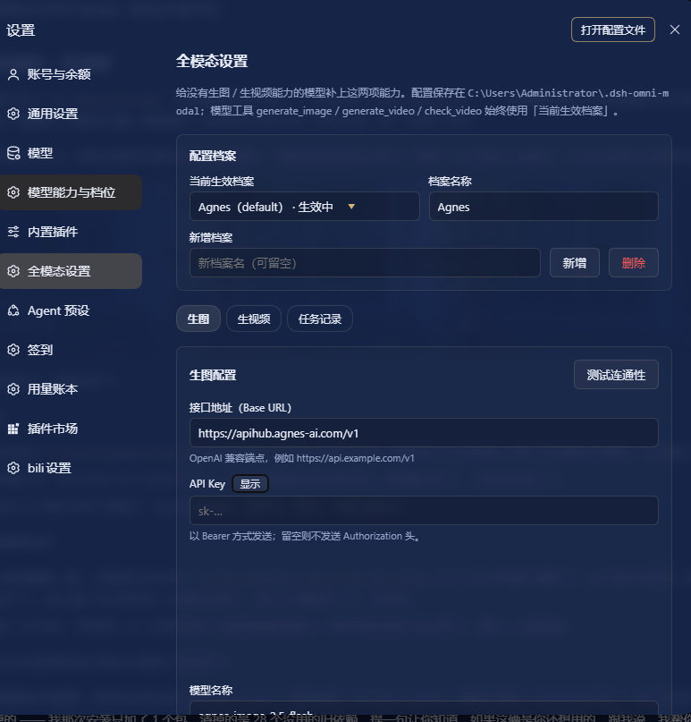
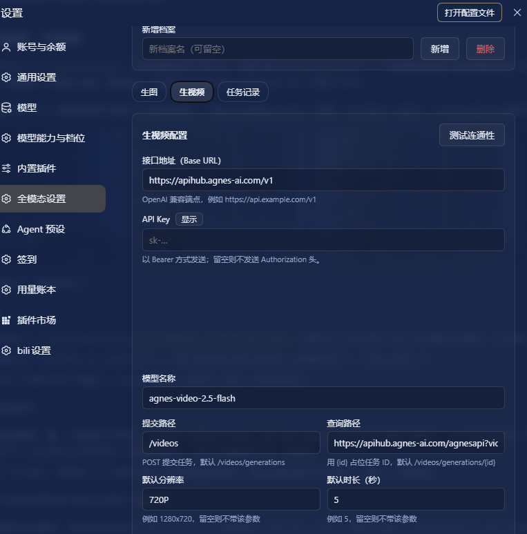

# dsh-omni-modal

[](LICENSE)
[](https://github.com/topics/dsh-plugin)

**Give a text-only model the ability to draw pictures and shoot videos — without touching a single line of DeepSeek Harness source.**

`dsh-omni-modal` adds an **Omni-modal settings** section to the DSH settings sidebar, where you can point the harness at any **OpenAI-compatible** image / video endpoint and register three model-visible tools:

| Tool | What it does |
| --- | --- |
| `generate_image` | Synchronous text-to-image. Saves the PNG/JPEG/WebP to disk and (when the attachment service is available) returns an inline preview card. |
| `generate_video` | Asynchronous submit. Returns a task id immediately — the clip is still rendering. |
| `check_video` | Poll that task; on success it downloads the finished video to disk. |

Status: usable, tracks the Harness developer preview — interfaces may change.





## Features

- **Live-editable settings page** — a real DSH settings section (not a static skill). Change endpoint, key, model, path or default size and hit **Save**; the three tools pick it up on their next call, no restart.
- **Multiple config profiles** — keep several endpoints side by side, name them, switch the active one at a time. Every tool also accepts an optional `profile` argument to use a non-active profile for a single call.
- **Separate image and video configuration** — the two APIs rarely share a shape. Each profile carries an independent `baseUrl` / `apiKey` / `model` / path / size for each side.
- **Extra request parameters** — a free-form JSON object merged into the request body, for endpoint-specific knobs (`{"quality":"high"}`, `{"mode":"text","aspect_ratio":"16:9"}`, …).
- **Connectivity test** — one click probes `GET <baseUrl>/models` (falling back to the base URL itself) without spending generation quota.
- **Async video by design** — submit, remember the task, poll later. Task records survive restarts.
- **No build step** — plain ESM host half plus a hand-written CJS client bundle. Nothing to compile, no bundler needed.

## Install

Requires Node.js ≥ 18 and DeepSeek Harness.

```bash
dsh plugin --profile <profile> add github:yzhclcl/dsh-omni-modal
```

`<profile>` is your DSH profile name (`web`, `desktop`, …). Add `#v0.1.0` to pin a tag.

Then **restart DSH** — the host half registers its routes and tools at boot, and the settings section appears under **Settings → Omni-modal settings**.

### Manual install (no pnpm / offline)

Copy this repository somewhere permanent, then add it to `~/.dsh/profiles/<profile>/package.json`:

```jsonc
{
  "dependencies": {
    "dsh-omni-modal": "link:/absolute/path/to/dsh-omni-modal"
  },
  "dsh": {
    "profile": {
      "bundles": ["dsh-omni-modal"]
    }
  }
}
```

and mirror the same entry into the `importers.` → `dependencies` block of `pnpm-lock.yaml`, then create the link:

```powershell
New-Item -ItemType SymbolicLink `
  -Path "$HOME\.dsh\profiles\<profile>\node_modules\dsh-omni-modal" `
  -Target "/absolute/path/to/dsh-omni-modal"
```

> **Never copy the package into `node_modules` instead of linking it.** DSH uses a `Symbol` as the cross-module call key; loading the module twice makes those symbols unequal and every tool call then throws `Cannot read properties of undefined (reading 'prepare')`, with no recovery after a restart.

## Usage

Once installed, just talk to the agent:

- *"Draw a strawberry on a pale blue plate."* → `generate_image`
- *"Make a short video of a paper boat drifting down a stream."* → `generate_video`, then `check_video`

### Settings page

| Section | Contents |
| --- | --- |
| Config profiles | Pick the active profile, rename it, add one (copied from the current) / delete one |
| Image | Base URL, API key, model, request path, default size, extra request params |
| Video | Base URL, API key, model, submit path, query path, default resolution, default duration, extra request params |
| Task records | Submitted video tasks with their status and artifact path |

Notes:

- **Saving takes effect immediately** for the tools — no restart.
- **The base URL must be the address alone.** Documentation examples are easy to copy verbatim as `POST https://api.example.com/v1`; the plugin strips a leading `POST`/`GET`/… automatically, but writing just `https://api.example.com/v1` is safer.
- **The query path accepts two forms**: a relative path (`/videos/generations/{id}`) appended to the base URL, or a **full URL** (`https://api.example.com/agnesapi?video_id={id}&model_name={model}`) used as-is. The full form is necessary when the query endpoint does not live under the base URL.
- Placeholders available in the query path:

  | Placeholder | Replaced with |
  | --- | --- |
  | `{id}` | the task id returned by the submit call |
  | `{model}` | the model name configured in that profile |

- The tools **always use the active profile** unless you pass `profile` explicitly.

### Tools

```
generate_image(prompt, size?, model?, profile?, save_to?)
generate_video(prompt, model?, profile?, size?, seconds?, image_url?)
check_video(task_id, profile?, save_to?)
```

- `generate_image` returns synchronously. The file lands in the plugin data directory's `media/` and, if the attachment service is available, an image attachment is produced so the picture shows up in the conversation. **The model itself cannot see the pixels** — to actually look at the image, call `read_image` on the returned path.
- `generate_video` is asynchronous: it returns a `taskId` right away. Call `check_video(task_id)` later; when the status becomes `succeeded` the artifact is downloaded into `media/` automatically.
- Passing a **non-existent profile is a hard error** that lists the available profiles, rather than silently falling back to another one — otherwise the model would quietly use the wrong endpoint and model while the result still claims the profile it asked for.
- `check_video` failures are **soft failures**: a missing task (404), an unreachable download URL or a failed download return `status: "failed"` / `"succeeded"` plus a `message`, instead of throwing. These are expected business outcomes, and throwing would abort the whole tool-calling round.
- Video URL extraction covers the common response shapes: `video_url` / `videoUrl` / `url`, nested `video.url`, `data.*`, `output.*`, `result.*`, `videos[0].url`, and more.
- Task id extraction prefers `video_id` / `videoId` over `id` / `task_id` — some services (Agnes, for instance) return an internal id that cannot be used for polling.
- **429 (rate limit) / 503 (busy, queue full)** responses come back with a "retry in a moment" hint: they are retryable server states, not configuration errors.

## Example: Agnes AI

Agnes AI's image and video endpoints have different shapes; the video side needs the official parameter set. Using `apihub.agnes-ai.com`:

**Image**

| Field | Value |
| --- | --- |
| Base URL | `https://apihub.agnes-ai.com/v1` |
| Model | `agnes-image-2.5-flash` |
| Request path | `/images/generations` |
| Default size | e.g. `1312x736` |

**Video**

| Field | Value |
| --- | --- |
| Base URL | `https://apihub.agnes-ai.com/v1` |
| Model | `agnes-video-2.5-flash` |
| Submit path | `/videos` |
| Query path | `https://apihub.agnes-ai.com/agnesapi?video_id={id}&model_name={model}` |
| Default resolution | `720P` (Flash only accepts `720P`; anything else returns 400) |
| Default duration | `5` (a string, range `"4"`–`"12"`) |
| Extra request params | `{"mode":"text","aspect_ratio":"16:9"}` |

- Video submission is `POST /v1/videos` (**not** `/v1/videos/generations`), and `mode` is required (`text` / `keyframe` / `reference`) — put it in the extra params.
- Polling goes through `GET /agnesapi?video_id=…&model_name=…`, which is **outside `/v1`**, hence the full URL in the query path.
- Output dimensions follow `aspect_ratio`: `21:9`→1680x720, `16:9`→1280x704, `4:3`→960x720, `1:1`→720x720, `3:4`→720x960, `9:16`→720x1280.
- The free tier is rate-limited fairly aggressively; repeated calls in a short window will return 429, and it recovers after a wait.

## Data locations

| What | Where |
| --- | --- |
| Configuration | `~/.dsh-omni-modal/config.json` (contains the API key, mode 0600) |
| Generated artifacts | `~/.dsh-omni-modal/media/` |
| Video task records | `~/.dsh-omni-modal/tasks.json` |

Set `DSH_OMNI_DATA_DIR` to relocate all of it (handy for isolated testing).

## Uninstall

```bash
dsh plugin --profile <profile> remove dsh-omni-modal
```

For a manual install, drop the dependency and bundle entries plus the `pnpm-lock.yaml` entry, then remove the link:

```powershell
cmd /c rmdir "$HOME\.dsh\profiles\<profile>\node_modules\dsh-omni-modal"
```

> Removing a symbolic link must be done with `cmd /c rmdir` or `[IO.Directory]::Delete(path, $false)`; **never `Remove-Item -Recurse`**, which follows the link and deletes the source directory. Quit DSH completely first.

`~/.dsh-omni-modal/` holds your data — delete it yourself if you want it gone.

## Implementation notes

- `lib/index.js` — the host half (Node ESM): config storage, the `/omni-modal/*` routes, and the three tool definitions.
- `lib/client.js` — the browser half (a hand-written CJS bundle loaded through `window.__ModuleLoader__.load`): registers the `settings.section` slot and renders the settings page.
- `cordis.patch.yml` — the plugin registry insert row, carried by `dsh.bundle.patch`.

The host half imports **no bare `@deepseek-ai/*` modules** (third-party plugins cannot resolve those internal exports) — only `node:*` and relative paths. Tool parameter and output schemas are written as **standard JSON Schema** (`required` as a string array) rather than the `defineTool` property-map DSL, which would make the LLM API reject the whole function schema.

## 中文文档

见 [README.zh.md](README.zh.md).

## License

[MIT](LICENSE)
